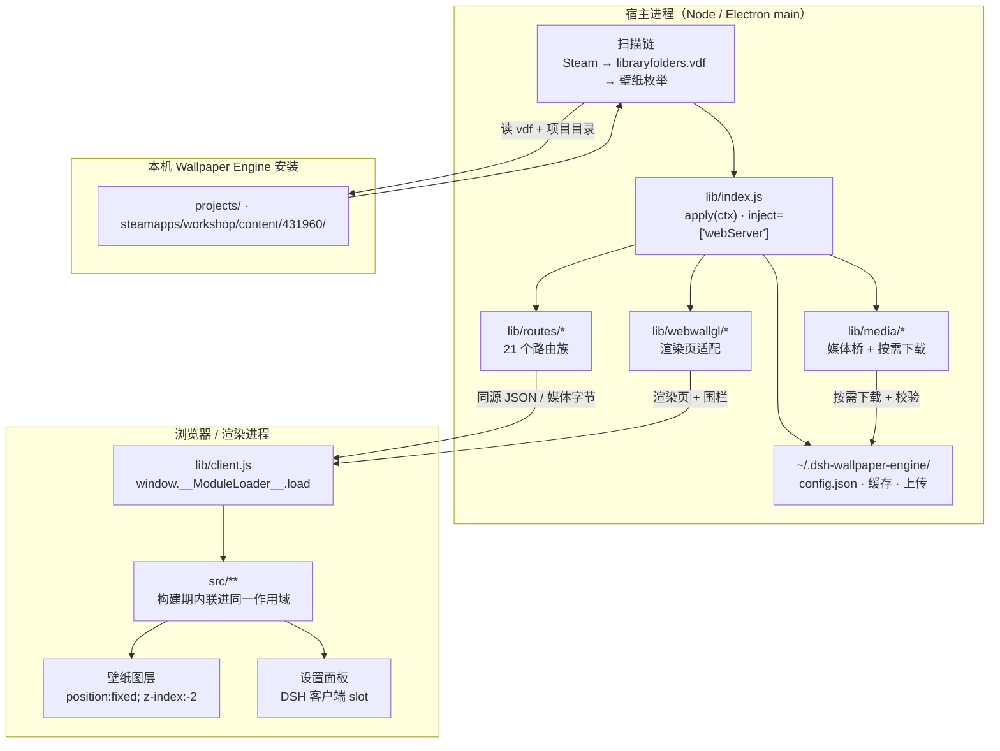

# dsh-wallpaper-engine 研读笔记

> **研读对象**：[`elysia395/dsh-wallpaper-engine`](https://github.com/elysia395/dsh-wallpaper-engine)
> **研读时点**：2026-10-22，对应 `package.json` 版本 **v1.3.3**（npm 已发布，2026-10-15）
> **研读方式**：浅克隆源码 + 通读 54 份官方文档 + 子代理双线梳理 `lib/**` 与 `src/**` 实现
> **本文定位**：外部项目研读归档，**不反映本项目实现**。所有路径均指该仓库内部路径。
> **用途**：① 作为「桌面壁纸 + 液态玻璃 + 进应用视觉」这类形态的技术参考；② 学习其工程方法学（这是本仓最有价值的部分）

---

## 目录

- [一、这是什么](#一这是什么)
- [二、规模与体量（实测）](#二规模与体量实测)
- [三、顶层架构：一份包，两个半边](#三顶层架构一份包两个半边)
- [四、宿主半边（`lib/**`）](#四宿主半边lib)
- [五、浏览器半边（`src/**`）](#五浏览器半边src)
- [六、核心技术专题（逐条深挖）](#六核心技术专题逐条深挖)
- [七、工程方法学（最值得学的部分）](#七工程方法学最值得学的部分)
- [八、配置、数据与目录](#八配置数据与目录)
- [九、已知边界与有意的取舍](#九已知边界与有意的取舍)
- [十、对本项目的启示](#十对本项目的启示)
- [十一、关键文件索引](#十一关键文件索引)
- [十二、复算命令](#十二复算命令)

---

## 一、这是什么

### 1.1 一句话

**一个 DeepSeek Harness（DSH）插件，把本机 Wallpaper Engine 的场景 / 网页 / 视频壁纸渲染到 DSH 对话界面后方，再配上液态玻璃、字体自定义、吉祥物与可分享的外观预设。**

关键在于它不是"贴一张背景图"——它把 **Wallpaper Engine 的场景包真正跑起来了**。

### 1.2 三类壁纸的落地方式

| 类型 | 落地路径 | 支持情况 |
|---|---|---|
| **Scene（场景）** | 内置 WebWallGL 实时 WebGL 渲染；失败走降级链 | ✅ 支持，**不需要 WE 在后台运行** |
| **Web（网页）** | 网页挂载 + WE API shim 注入 + 严格沙箱 | ✅ 支持；效果取决于网页与浏览器能力 |
| **Video（视频）** | 浏览器原生 `<video>`；配转码、帧率上限、暂停控制 | ✅ 支持 |
| **Application（应用）** | 需要宿主启动第三方可执行程序 | ❌ **有意不支持**（见 ADR-0001 D4） |
| **自定义图片 / 视频** | 上传本地 JPG / PNG / MP4 | ✅ 支持，文件保存在本机 |

Application 类不做，是本项目一条明确的边界：插件不替用户跑外部程序。

### 1.3 能力清单

| 方向 | 能力 |
|---|---|
| 实时壁纸 | WebWallGL 渲染 Scene / Web，支持粒子、puppet 骨骼、SceneScript、鼠标交互、音频反应 |
| 液态玻璃 | 设置窗口、对话区、侧栏、标题栏、思考条、浮层，各面可独立配置 |
| 外观预设 | 整套配置快照（外观与行为键全带 + 字体 / 吉祥物 / 头像三族资产按需携带），JSON 导出 / 导入 / 分享 |
| 字体与配色 | 按颜色角色、排版角色、组件三级细调；系统字体枚举；独立光标颜色 |
| 吉祥物 | 10 只内置立绘 + 自定义导入，3D 圆环转盘选择 |
| 壁纸库 | 内容分级 / 类型筛选、批量隐藏、自定义上传、WE 项目目录收录、自动轮播 |
| 播放与降载 | 帧率上限、转码缓存、倍速、水平翻转、切换过场、遮挡暂停 |
| 音乐联动 | 系统输出回环频谱、Now Playing 与封面、可选在线歌词 |
| 扩展效果 | 会话头像、点击 / 拖尾光效、壁纸与界面 3D 视差 |
| 宿主适配 | Windows / macOS / Linux 同一份 npm 包；界面跟随 DSH 语言 |

**明确声明**：不向 agent 注册工具、不注入提示文本 ⇒ **零模型 token 开销**。这一条在一个"什么都要挂个 MCP 工具"的生态里很克制。

---

## 二、规模与体量（实测）

在克隆目录下现算：

| 部分 | 文件数 | 行数 | 说明 |
|---|---|---|---|
| `lib/**/*.js` | 56 | **12,711** | 宿主半边（Node 侧），含 21 个路由族 |
| `src/**/*.js` | 73 | **23,911** | 浏览器半边；其中 72 个被构建期内联（`src/client.js` 本身是正文，不内联） |
| `test/**/*.mjs` | 97 | **46,028** | 守卫 + 冒烟 + e2e + 工具 |
| `docs/**/*.md` | 54 | **9,900** | 官方文档（不含三份 README） |

**测试代码行数是生产代码的 1.28 倍**（46k vs 36k）。这个比例本身就说明了这个项目的重心在哪里。

依赖极简：

```json
"dependencies": { "webwallgl": "^3.0.0", "x11": "^4.3.1" }
```

生产依赖只有两个。ffmpeg、媒体中间件都是**按需下载 + sha256 校验**，不在依赖表里。

`peerDependencies` 五个（cordis / dsh-client-runtime / dsh-client-ui-slots / dsh-host-webserver / react），其中三个 `dsh-*` 标 `optional`。

---

## 三、顶层架构：一份包，两个半边

这是理解整个项目的**第一把钥匙**，也是文档里反复强调、最容易被误判的一层。

### 3.1 一个 npm 包，两种身份

| 身份 | 入口 | 谁加载它 | 跑在哪 |
|---|---|---|---|
| **Cordis 宿主插件** | `lib/index.js` 的 `inject` / `apply(ctx)` | DSH 宿主按 bundle patch 行装载 | Node（Electron 主进程侧） |
| **DSH 客户端插件** | `lib/client.js`（`exports["./client"]` + `package.json` 的 `dsh.client`） | DSH **客户端加载器**按包元数据取 | 浏览器 / 渲染进程 |

**两条加载路径互不知道对方存在**，唯一接口是 **HTTP 路由表**。



### 3.2 两侧的能力边界（改完怎么生效——最容易踩的坑）

| | **宿主半** | **浏览器半** |
|---|---|---|
| 入口 | `lib/index.js`（`package.json` 的 `main`） | `lib/client.js`（由客户端加载器消费） |
| 源码在哪 | **就是 `lib/*.js` 本身**（手写、直接发布） | **`src/**`**：`src/client.js` 是正文，其余构建期内联 |
| 可用什么 | `node:*`、`worker_threads`、`child_process`、`fs` | `document`、`fetch`、DSH 客户端 ctx；**无 `node:`、无 `import`** |
| **改完怎么生效** | **必须重启 DSH**（启动时加载一次，不热更） | `npm run build` 重新生成 `lib/client.js`，**刷新页面**即生效 |

> **这是本仓排障文档的第一条**（`docs/TROUBLESHOOTING.md` §「改了插件却完全没作用」）。
> 实测踩过：大场景壁纸的首帧超时修复"像没生效"，实际是宿主半从未重载。
> 文档还给了三条现场判据（新宿主才有的路由 / `inventory` 才有 `scenePkgBytes` / `build-stamp.json` 的 `at` 与源文件 mtime 对照）。

### 3.3 `webServer` 是硬依赖

`lib/index.js` 声明 `export const inject = ['webServer']`。由 Loader 等待 HTTP 服务就绪 —— **无 HTTP 服务的 profile 根本不加载本插件**，而不是加载后崩溃。这是"失败形态"设计的一个好例子。

### 3.4 一切注册都经 fiber

路由、媒体源、定时器、子进程全部把 disposer 推进同一个 `disposers` 数组，卸载 / HMR 时**逆序回退**：

```js
// lib/index.js apply() 收尾（1464-1478 附近）
// 逆序跑所有 disposer → ensuredDirs.clear() → disposeTranscodes()
// → 逐个 destroy() 在途流 → activeStreams.clear() + mediaMap.clear()
```

文档原文：「这条不是可选的 —— 否则卸载 / HMR 后会留下挂着的处理器。」

---

## 四、宿主半边（`lib/**`）

### 4.1 `lib/index.js` 是门面，不是巨石

`apply(ctx)` 的编排顺序（有硬约束）：

1. 写 `build-stamp.json` 版本戳 → 取 `ctx.webServer`（无则返回空 disposer）→ 建 `log` / `notice`
2. 建 `mediaMap`（token → 绝对路径）与 `tokenFor`
3. 建套件：`mp4-vfs` → `faststart` → `scene-probe`（**全局唯一实例**，`/inventory` 与 `/scene-video` 必须共用）
4. 3 秒后延迟清扫缓存（推迟到加载完成之后）
5. 建 `serve` → `media-origin` → `inventory`（**顺序有硬约束**：serve 早于 media-origin，inventory 晚于 media-origin）
6. 按族注册 21 个路由族
7. 返回 fiber disposer

**门面里只剩三类东西**，不是待拆的巨石：

- **注册与编排**：建套件、按族注册、推进 fiber
- **共享可变状态 + 访问器**：媒体源地址、载荷账本、缓存索引必须与 `/inventory` 同作用域 ⇒ 跨模块只能以**访问器**形式出去（**传值就是陈旧快照**）
- **目录解析器与配置路径**：`pluginDataDir()` / `configPath()` / `cacheBaseDir()`，它们带着守卫的文本锚点，所以留在门面

### 4.2 21 个路由族（`lib/routes/`，一文件一族）

前缀统一 `BASE = /wallpaper-engine`：

| 文件 | 主要路由 | 用途 |
|---|---|---|
| `upload.js` | `/upload`、`/remove`、`/upload-dir` | 导入（流式落盘、sha256 去重）、删除、切换上传目录 |
| `media-bytes.js` | `/media`、`/preview` | 原片 / 预览字节直出，`/media` 经 `pinnedFaststartVariant` 钉布局 |
| `media-derived.js` | `/media-info`、`/transcode-progress`、`/transcoded`、`/video-preview` | 容器探测、抽帧转码、缩略图 |
| `scene-serve.js` | `/scene-live`、`/scene-files`、`/media-origin`、`/scene-payload-progress` | 渲染页、壁纸自有文件、媒体源地址、载荷进度账本 |
| `scene-frame.js` | `/scene-frame`、`/scene-frame-cache`、`/custom-frame` | 实时抓帧缓存、自定义画面 |
| `scene-media.js` | `/scene-video`、`/scene-audio` | 场景包内嵌 MP4（按需提取+去重）与独立音轨 |
| `now-playing.js` | `/media-status`、`/audio-spectrum`、`/now-playing`、`/media-control` | 媒体后端懒启动；四读一写 |
| `props.js` | `/props` | 壁纸用户属性当前值 + 候选文件 |
| `live-frame.js` | `/live-frame` | 网页壁纸首帧 JPEG 缓存 |
| `settings.js` | `/settings` | GET 已存设置；PUT 规范化落盘 |
| `cache-dir.js` | `/cache-dir`、`/cache-dir/browse` | 切换缓存根；宿主列目录供面板浏览 |
| `fontsets.js` | `/fontsets`（prefix，7 端点） | 字体集 list/get/put/delete/activate/import/export |
| `presets.js` | `/glass-presets`（prefix，7 端点） | 预设 list/get/create/delete/install-assets/export/import |
| `we-assets.js` | `/api/local-assets`、`/we-assets-dir` | WE 官方素材只读直出 |
| `avatar.js` | `/avatar` | 会话头像 `user`/`ai` 两方 |
| `mascot.js` | `/mascot` | 吉祥物立绘导入 / 查看 / 清除 |
| `about-qr.js` | `/about-qr` | 「关于」二维码，白名单查表直出 |
| `github-stars.js` | `/star-count` | **唯一出站请求**，10min TTL + 落盘缓存兜底 |
| `system-fonts.js` | `/system-fonts` | 三平台本机字体清单，双层缓存 |
| `diag.js` | `/client-diag`、`/diag`、`/diag-log` | 客户端上报、渲染页告警环形缓冲 |
| `occlusion.js` | `/occlusion` | 遮挡快照只读端点 |

**族不必背下来**：路由表的真源是生成物 `docs/ROUTE-INDEX.md`（由 `test/tools/host-route-index.mjs` 重算并**逐字节核对**）。

> **这条纪律很硬**：文档明确写「手写必烂 —— 那张表曾长期列着三条**早已删除**的路由，还漏了当时大半的路由」。
> 所以现在**文档里不写路径表、也不写条数**，一律指向生成物。

### 4.3 `lib/settings-schema.js` —— 设置的唯一真源

约 1253 行。**宿主与客户端都从它派生**，构建期剥 `export` 内联进客户端 bundle ⇒ **必须浏览器安全**（这条与 §5.1 的"剥 export 内联"是同一件事的两面：schema 既是宿主模块，又是客户端的内联模块）。

结构（实测导入该模块后取值）：

| 段 | 规模 | 内容 |
|---|---|---|
| 枚举白名单 | 30+ 个常量 | `RATING_VALUES` / `TYPE_VALUES` / `OBJECT_FIT_VALUES` / `ROPE_FORM_VALUES` / `FONT_FAMILY_VALUES` / `SWITCH_TRANSITION_VALUES` / `ADAPTER_TARGET_VALUES` / `FX_*_VALUES` … 统一在文件顶部 |
| `DEFAULTS` | **146 键** | 默认值大表（`SETTINGS_VERSION = 6`） |
| `DEFAULTS_ONLY` | **5 键** | 只做默认值，不 sanitize、不持久化：`rotationInterval` / `sceneFrameUrl` / `themeTypeOnly` / `fontAdvanced` / `fontSetOpen` |
| `CLIENT_ONLY` | **2 键** | 只存 localStorage，宿主拒收：`frameVariants` / `customFrames` |
| `KINDS` | **142 键 / 24 种 `kind`** | 每键校验元数据：`num`（min/max）/ `enum`（values）/ `boolTrue` / `boolFalse` / `const` / `hex` / `str` / `strArray` / `map` / `props` / `failures` / `groups` / `modeMap` / `extraSelectors` / `themeColors` / `typeSizes` / `typeWeights` / `typeFamily` / `familyKey` / `componentFonts` / `glassColors` / `avatarFile` / `mascotFile` / `mascotBox` |

三个数字**故意不等**，因为它们的职责本来就不同：`DEFAULTS` 多出的 5 个正是 `DEFAULTS_ONLY`；`KINDS` 比 `DEFAULTS` 多一个 `id`（选中项，是设置项但不是默认值项）。这个"三张表刻意不齐"是有意的结构，不是疏漏。

**校验方式不是"数字等于 N"**，而是**键集恒等式**（`test/verify-client.mjs` ⑤d）：

```js
persisted（持久化白名单） ≡ clientSan（客户端 sanitize 键集）
hostSan（宿主接受键集）   ≡ clientSan − CLIENT_ONLY
```

> 全程**派生，无手写清单** —— 测试注释明确写了「从两边源码文本里抠键名这条路不可行……抠名字也证明不了"宿主真的会接受"」。
> 所以加了键没登记会红，但红的理由不是"数字不对"，是**三个派生集合对不上**。

代表性键：

```js
blur:              { kind: 'num',  min: 0, max: 60 }
switchTransition:  { kind: 'enum', values: [...] }
videoAudioEnabled: { kind: 'boolTrue' }     // 只能为 true
settingsVersion:   { kind: 'const' }
glassMode:         { kind: 'modeMap' }      // inherit / custom 两态
mascotImageBox:    { kind: 'mascotBox' }
```

派生段（都是算出来的，不是手写的）：

| 常量 | 值 | 怎么算出来 |
|---|---|---|
| `PROFILE_PRESET_KEYS` | **117 键** | `KINDS − DEFAULTS_ONLY − CLIENT_ONLY − PRESET_ASSET_KEYS − PRESET_EXCLUDED_KEYS` |
| `PRESET_ASSET_KEYS` | 11 键 | 字体 / 吉祥物 / 头像三族资产 |
| `PRESET_EXCLUDED_KEYS` | 12 键 | 预设里排除的键 |
| `RESET_MODULES` / `RESET_TABS` | 对象 | 重置模块 / 页签两级；∪ `RESET_TABS_EXCLUDED`（7 键）== 全部可重置键，且互不重叠 |
| `FONTSET_KEYS` | 7 键 | 字体集的状态键 |

> 那个 **117** 与 README 写的「116 键快照」差 1，是不同时点的口径差（预设键集随版本增删）。本文遵循项目自己的纪律：**这类会漂的数不写死**，给的是复算方式。

> **加一个设置项的配方只有两步**：`DEFAULTS` 加默认值、`KINDS` 加校验规则。**都在同一个文件里**。
> 漏登记的后果是"客户端设置被**静默丢弃**"（改了没生效、重启回默认）——本仓历史上真实发生过，
> 正是单一真源要消掉的东西。

### 4.4 关键套件的接缝判据

这个项目对"为什么单独成模块"给出了很清晰的判据：**同一份推导被两个互不相干的消费者读到**（或者反过来，同一件事存在两个可以出错的实现）。

| 模块 | 职责 | 接缝判据 |
|---|---|---|
| `media-probe.js` | MP4/MOV 容器探测：一次 moov 盒走读得尺寸/编码/帧率/时长/moov 落点 | 同一份走读被两个消费者读：`/media-info` 的面板提示 + 转码的「源帧率 ≤ 上限就跳过」决策；`moovStart`/`moovSize` 又是 `mp4-vfs` 的 faststart 判据。**抄两份就会各自漂移** |
| `scene-probe.js` | 两本探测账：独立音轨（BGM）+ 主文件是否内嵌 MP4 | 两件事消费者完全重合。分开写会出两套缓存键、两套陈旧判定 ⇒ 同一份 pkg 被探两次、两个回答还可能不一致 |
| `wallpaper-scan.js` | 「目录树 → 清单条目」的唯一推导链 | 三个磁盘探测与 Steam 安装探测族共用同一实现，注入后"扫描根少算一个"只剩一个出错点 |
| `cache-prune.js` | 启动期缓存清扫 + 容量上限 | 四件事共享同一条纪律「只清本进程不拥有的、且够旧的孤儿产物」 |
| `config-store.js` | `config.json` 的读、原子发布、**读-改-写串行化** | `config.json` 被目录设置、上传元数据、字体集状态等多个业务面读改写共用，**每次都必须过同一条队列**（并发时后写者会基于旧快照吞掉先写者的改动） |

> **共同不变量**：套件不自己决定"缓存放哪" —— 音轨产物落点、原子落盘、三个目录都由门面注入。

### 4.5 `lib/webwallgl/` 适配页

- `index.html`（52 行）：极小壳页，`#wp` 容器；**经典脚本先加载** `./engine/webwallgl.global.min.js`，再 `type="module"` 加载 `./renderer.js`
- `renderer.js`（10.33 KB）：引擎来自 npm 依赖 `webwallgl`（`window.WebWallGL`）；宿主适配层负责 URL 协议解析（`type`/`src`/`mediaBase`/`fit`/`sceneFps`/`muted`/`renderDpr`/`vidscale`/`autoq`/`bake`）、滤镜白名单、诊断信标、控制面 `window.__wp`
- 引擎文件由宿主运行期从 `node_modules/webwallgl` 供给，挂在 `engine/` 前缀下；依赖未安装即 404 `webwallgl-not-installed`
- `index.html` 注入 `occlusion-bridge.js?v=<sha256前12>`，桥文件只认 `e.source === window.parent && __weLive === 1`

**ADR-0001 记录了为什么走这条路**：三条备选（离线渲染成静态帧 / 转码成视频 / 依赖 WE 在后台跑）各有致命代价 —— 前两条丢掉动画与交互，第三条要求用户购买并常驻 WE 且跨平台不可行。选了"内嵌实时渲染"，代价是包体积、保真度不是 100%、必须维护一条降级链。

### 4.6 `lib/media/` —— 系统媒体桥

「系统正在播放 / 音频频谱」后端门面（`media/index.js`）：

- 优先 **media-bridge 子进程**，失败回落内置实现
- `provision.js`：产物解析四级链 —— env `DSH_WE_MEDIA_BRIDGE` → 插件旁 `bin/` → `<dataDir>/bin/media-bridge/<tag>/` → GitHub Release 下载（sha256 固定）
- `supervisor.js`：**stdio NDJSON 协议**（刻意不用它的 HTTP 面，避免端口/CORS/孤儿进程）；`PROTOCOL_VERSION=1`、握手超时、退避重启、快照缓存 + positionMs 外推
- `legacy.js`：兜底实现（macOS Swift `audio-tap` + `media-control`；Linux `playerctl`；Windows 无）
- 校验：下载后 sha256 + magic，失败**不留坏文件**

---

## 五、浏览器半边（`src/**`）

### 5.1 没有模块系统 —— 构建期内联

**这是整个项目最反直觉、也最容易误判的一层。**

浏览器半边的真源是 `src/**`，但**运行时没有本地模块解析器**（加载器的 `require` 只服务外部包）。所以 `src/` 下的模块由 `scripts/build-client.mjs` 在**构建期**按 `INLINE_MODULES` 清单剥掉 `export` 后注入 `lib/client.js` 的**同一个工厂作用域**。

清单共 **73 条**，但**不全是 `src/` 文件** —— 其中 72 条是 `src/*.js`，还有 1 条是宿主侧的 `lib/settings-schema.js`（设置真源要双端共用，所以也被内联）。而 `src/client.js` 本身**不在清单里**：它是 `lib/client.js` 的正文，是被注入的目标，不是被注入的模块。

```js
// scripts/build-client.mjs —— 一条的形状
{
  file: 'src/your-module.js',
  why: '一句话说明它为什么独立成文件',
  markers: ['const YOUR_EXPORT = ', 'function yourHelper('],   // 缺任一 ⇒ 构建硬失败
}
```

清单**顺序即注入顺序**，是单一真源。条目按功能分组排列：i18n 词表、样式域模板、字体、面板页签、媒体管线、玻璃、光效 / 视差 / 头像、live-layer 一族……

构建期四道断言：

| 断言 | 实现 | 失效后果 |
|---|---|---|
| `markers` 锚点在位 | 逐条 `if (!text.includes(marker)) exit 1` | 结构变了就红（**只许换不许减**） |
| 浏览器安全 | 先剥注释再匹配 `import` / `require(` / `export default` / `process.*` / `__dirname` / `__filename` | 硬失败 |
| 名字不冲突（注入 ↔ 正文） | `DECL_RE` 机器提取顶层声明名，口径 = "缩进 == 本文件最小缩进" | `exit 1` |
| 名字不冲突（模块之间） | `assertNoShadowedScopeDecls()` 扫全部产物 | 报 `name —— file:line 与 file:line（后者胜出）` |

> ⚠️ **唯独漏登记 `INLINE_MODULES` 不报错** —— 那个文件永远不进产物，调用点一到运行期就是 `ReferenceError`。
> 文档明确写「这是本路线最危险的失效模式（本仓踩过一次）」。

### 5.2 "同一作用域"意味着什么

模块之间**不 import**，却共享**一个扁平符号命名空间** ⇒ "这个模块从哪拿外界"不是靠 import 表达的，而是靠**谁在文件头声明了它**。

角色分四类（文档 §3.1 有完整表）：

| 角色 | 代表模块 | 谁给它外界 |
|---|---|---|
| **状态真源 + 装配（门面）** | `src/client.js`（正文约 4460 行） | 自己持有 `selection` store、持久化、`apiFetch`、React 根、`ctx` 组装点 |
| **接收 `ctx` 的渲染 / 行为层** | `live-layer`、`panel-tabs*`、`glass-panel`、`ext-*`、`font/apply` | **门面在调用点组装 `ctx` 传进来** —— 这一层**不**直接读 `selection` |
| **基座（无 `ctx`，读扁平符号）** | `we-base`、`media-prep`、`layer-core`、`glass`、`effects`、`i18n`、`persistence` | 直接读同作用域符号 |
| **纯数据 / 常量表** | `styles-*.js`、`i18n-copy-*.js`、`font/typography.js` | 无外界 |

**依赖方向单向，但两侧含义不同**：

- 正文 → 模块（给 `ctx`，或读模块的顶层声明）＝ **常规**
- 模块 → 正文的**顶层读**是**禁止**的：注入点在 bundle **顶部**、早于正文 ⇒ 撞 **TDZ**
- 反过来"模块把符号导出给正文读"是**允许**的

> **改一个常量前必须先确认它住哪个文件**：改错了地方会"看起来改了却没生效"。

### 5.3 样式与令牌：三层入口，各改一处

界面样式**不在任何 `.css` 文件里**（除了 `lib/webwallgl/` 那套 vendored 渲染页）。

| 层 | 真源 | 怎么生效 |
|---|---|---|
| **整份样式表** | `src/styles-*.js` 域模板 + `src/styles.js` 组装点（纯数据） | 构建期内联；运行时 `ensurePluginCss()` 把同一个 `<style>` 挂进 `document.head`，带 `data-plugin-css` 与**代际**标记 |
| **运行时令牌**（`--we-*`） | `src/effects.js` 的 `applyEffects()` 写 `document.body.style`；玻璃那一族在 `src/glass.js` | 样式表读 `var(--we-*)`；设置一变就重写 |
| **字体自定义** | `src/font/apply.js` | 独立通道，见 `FONT-SYSTEM.md` |

> **判据落在哪也照这个分**：`verify-readability` 会**从产物里抽出** `src/effects.js` 的钳制函数复算对比度网格
> ⇒「改样式表就能过判据」不成立。

### 5.4 壁纸图层

几何全在 CSS：

```css
.we-layer  { position: fixed; inset: 0; z-index: -2; overflow: hidden; pointer-events: none }
.we-scrim  { z-index: -1 }
html       { background-color: var(--we-wallpaper-underlay, transparent) }
```

- 取景用**独立属性** `translate` / `scale`（不是 `transform`）
- 层节点复用：`obtainLayerNode()` —— 已存在同 id 就复用（`weFading=1` 视为废层）→ 节点级领养（**不重载 iframe**）→ 否则新建
- 两条通道共用切换核心 `layer-core.js`：旧层 `zIndex="-3"` 压到新层之下 → `--we-switch-ms` → 强制 reflow → `scheduleFadingLayerRemoval()`（`ms+100` 宽限后释放媒体 + 放行音频闸）
- `releaseLayerMedia()` 对 iframe 显式 `about:blank` **终止在飞请求**

### 5.5 设置面板结构

**六个页签不是六个 slot**，而是同一个组件内的内部页签：

```js
PICKER_TABS = [library, appearance, playback, system, extensions, about]
```

**只有一个 slot 注册点**：

```js
ctx.slots.inject("settings.section", () =>
  ctx.slots.register({ name: "settings.section", id: "wallpaper-engine", order: 500,
                       label: () => weT("壁纸引擎") },
                     () => React.createElement(WallpaperPickerSection)))
```

面板组装点 `panel-tabs.js` + 五个域模块：

| 域模块 | 渲染什么 |
|---|---|
| `panel-tabs.js` | 组装点：八个 `render*Tab` + `extensionModules()` 惰性注册表 + 重置节 |
| `panel-tabs-wallpaper.js` | 当前壁纸 / 切换过场 / 轮播 / 上传 |
| `panel-tabs-appearance.js` | 主题 / 细节 / 字体 / 侧栏圆角 / UI 配色 |
| `panel-tabs-mascot.js` | 3D 圆环转盘（`MASCOT_BOX_PX=64`、`RING_FACTOR=1.15`、`PERSP_PX=820`、`FLING_S=0.32`） |
| `panel-tabs-effects.js` | 滑块 / 实时渲染 / 图源 / 播放 / 适配 |
| `panel-tabs-advanced.js` | 浏览 / 兼容 / 适配器 / 省电 / 缓存 / 诊断 |

**契约**：每个页签首行从 `ctx` 解构，**禁引 `selection` / `emit(` / 改写模块级状态**。

---

## 六、核心技术专题（逐条深挖）

### 6.1 独立 loopback 媒体源 —— 项目里最漂亮的一个解

**问题**：DSH Desktop 给**每条插件路由**都套了能力头栅栏（`x-dsh-desktop-renderer`，只注入给同源 frame 发出的请求）。而网页壁纸跑在 `sandbox="allow-scripts"` 的**不透明源**里，`frame.origin === "null"` ⇒ 永远拿不到这个头 ⇒ 壁纸入口一律 **403**。表现：预览图先正常、随后整块黑。

**解法**：宿主在 `127.0.0.1` 上**自开第二个端口**，只服务 `/scene-files/`，复用同一段 `handleSceneFiles`（目录围栏 / CORS / shim + seed / Range 全部一致）。

```js
server.listen(0, '127.0.0.1')   // 随机端口，不占固定号
base = `http://127.0.0.1:${port}`
```

- **端口分配**：`listen(0)` 由系统分配随机端口
- **何时启动**：**懒启动** `ensureMediaOrigin()`，单次决策（`mediaOriginDead` 起过一次失败就不重试）
- **门控**：网页壁纸按适配器形态门控（手选 browser 不启、手选 desktop 恒启、auto 看观测到的栅栏/shell）；**场景载荷无条件懒起**
- 显式探测 `GET /wallpaper-engine/media-origin` 绕开门控
- 媒体源不经过能力头栅栏 ⇒ 第三方 HTML 连宿主 origin 都不沾边，**沙箱之外又多一层隔离**

**场景壁纸为什么也走它**：不是为了绕栅栏，而是**为了载荷速度**。实测同一份 336MB 的 `scene.pkg`：

| 通道 | 耗时 |
|---|---|
| 独立媒体源 | **0.6 s** |
| 应用源 | 15 – 74 s，甚至永不返回 |

**还有一层优化**：`scene.pkg` 响应带 `ETag`（size+mtime）+ `Last-Modified`，条件请求命中即 **304 无体** —— 几百 MB 的包每次重建 live 层都重读一遍盘，靠这一条消掉。（入口 HTML 仍 `no-store`：它带注入的 shim 与属性种子。）

> 这条的设计记录在 ADR-0005；实施细节在 `lib/media-origin.js` 文件头。

### 6.2 出图降级链 —— "要么给真画面、要么明确留空"

**唯一权威顺序**（代码在 `lib/routes/scene-frame.js`）：

```
① 实时渲染 iframe
    → ② 场景作者内嵌 MP4（硬件解码 <video>）
        → ③ 实时抓帧（<key>_gpu.png，live 首帧确认后回填）
            → ④ 自定义画面（用户导入的截屏）
                → ⑤ 空态（404 + 可判定原因）
```

**首帧之前不留黑屏**：垫底画面按 **实时抓帧 → 作者随包发布的工程预览图 → 主题色** 取（`buildLivePoster`）。新壁纸第一次激活时抓帧还不存在，先由作者预览图占位，live 首帧一到即被顶掉。

**关键设计决定（P2-12）**：**没有 CPU 兜底出图**。0.6–0.7.x 曾用「离线场景渲染器 / 主纹理提取 / 工坊预览图」三级兜底，共同缺陷是**能"成功"产出一张劣质图** —— 绕过质量门禁、把糊帧写进缓存、让"这张壁纸没有可用画面"这个**可判定事实**退化成一张看似正常的画面。用户看到的是"壁纸糊了"，而不是"它没有画面"。整条线（约 1 万行）已删除。

> 契约变成：**要么给真画面、要么明确留空**（状态行给出可判定原因）。
> 客户端在首帧前 / 空帧时的占位仍会用**作者的预览图** —— 那是作者自己的图，不是插件合成的。

### 6.3 首帧预算与载荷账本

**首帧超时不是一个固定墙钟**：

```js
liveFirstFrameBudget(wid) = LIVE_FIRST_FRAME_MS(15000)
                          + ceil(scenePkgBytes / (8_000_000 / 1000))   // 按 8MB/s 估
// 夹在 [15000, LIVE_FIRST_FRAME_MAX_MS = 90000]
```

**宿主侧有一本载荷账本**：客户端轮询 `GET /wallpaper-engine/scene-payload-progress?token=…`，**字节还在涨就每拍重置计时** ⇒ "正在下载"不再被算成"渲染不出来"。

**首帧没出来还要分因**：

| 情形 | 处置 |
|---|---|
| 账本说"传过但没传完"（下载停滞 / 被别的实例饿死） | **只记会话内软失败**（不写所有窗口共用的失败记忆），冷却 **45 s** 后自动重试，每张至多 **2 次** |
| 渲染页真的不出帧 / 运行期失联 | 才按壁纸**落盘**失败记忆 |

**失败记忆分两层**：

- **共享设置**（`selection.sceneLiveFailures[wid]`，落盘，所有窗口共用）
- **会话内软失败**（`liveSessionFailures` Map，不落盘）

> 纪律：**一次被饿死的传输不该变成每个窗口的永久降级。**

**隐藏实例根本不拉载荷**：建层时延迟赋 `src`、切后台摘成 `about:blank` 中止在飞请求 —— 因为这种实例既出不了帧（Chromium 冻结隐藏页的 rAF），又会和**看得见**的那个抢带宽与解码器。

**管线身份作废**：`livePipelineNow()` / `livePipelineChanged()` / `migrateStaleLiveFailures()` —— 判据单向：bundle 变或 media 0→1 才清，且必须等 `selection.hostLoaded`。

### 6.4 抓帧与空帧门禁

**体积阈值不可靠**（实测全黑 PNG：960×540≈12KB、1080p≈44KB、4K≈165KB，都远超固定字节闸）。所以抓帧前把 canvas 降采样到 **`LIVE_FRAME_SAMPLE = 64`** 见方，看亮度分布：

```js
lit / n ≥ LIVE_FRAME_LIT_RATIO = 0.02   // 亮度阈值 12/255（BT.601）
variance ≥ LIVE_FRAME_MIN_VARIANCE = 4
```

近全黑或几乎无对比度 ⇒ 判为"还没渲染出画面"，**直接放弃回填**（保留旧帧），另加分辨率相关的体积地板 `LIVE_FRAME_BYTES_PER_PX`。

**抓帧几何校验（视口宽高比）** —— 一个很细的坑：

抓帧是「抓帧那一刻渲染页视口的构图」。在别的窗口 / 旧会话抓的帧拿到当前窗口上屏会被 CSS `object-fit: cover` **再裁一次**。实测一张 1440×960（3:2）的帧在 2488×1376 视口里只显示场景设计宽度的 **84.5%**，人物比 live 大约 **19%** 且四周被切。

所以宿主在 `HEAD /scene-frame/<token>` 上附带 `X-WE-GPU-W/H/AR`（读 PNG 的 IHDR，纯文件头）。客户端拿它与当前视口比对：

```
相对差 > 2%（与渲染器自己的 fit 容差同口径）或几何未知
  ⇒ 先抓帧过内容门禁、再清槽、再 PUT
```

> **清槽在抓帧之后**：抓帧失败时留下空槽会退回 CPU 帧，比留一张旧构图的帧更糟。
> 旧帧因此会在下次挂载 / 轮换时**自愈**，不必手动清理。

**「单主帧 + 面积升级制」**（v1.3.2 的修复，很值得看）：

一张壁纸可以被多个窗口同时实时渲染。旧实现每壁纸只有一份 `<key>_gpu.png`，而"存帧视比 ≠ 我的视口就清掉重抓"的规则让两个视比不同的窗口在每轮轮播到访时**互相清写对方的帧** —— 乒乓永不收敛。

推演过"按形状精确缓存"：互踢确实根治，但躲不开第二个成本 —— 窗口经常调整大小 ⇒ 每个新形状都会在轮播边界上为每张壁纸抓一帧落盘，**缓存份数随形状数无界增长**。

最终形态 = **单槽 + 只升不降**：

- 客户端探测主帧几何，**主帧面积 ≥ 我的画布（容差 5%）⇒ 保留**，显示侧 CSS cover 缩小（大帧缩小无损失）
- 主帧缺失 / 明显更小 / 几何未知 ⇒ 抓**我的尺寸** PUT 覆盖（升级）
- 宿主 PUT 侧再放一道**面积守卫**兜底竞态：来帧面积 < 盘上大帧 × 0.95 ⇒ **409 `frame-smaller`** 拒写

> 效果：写入次数 = 主帧面积单调升级的次数（带容差 ⇒ 个位数封顶），磁盘每壁纸恒定 1 帧，resize 扫过一堆中间形状时**零新增写入**。

### 6.5 虚拟 faststart —— 不落盘的媒体优化

**问题**：MP4 的 `moov` 盒如果排在 `mdat` 之后（非 faststart），浏览器要下完整个文件才能开始播放。几百 MB 的壁纸视频就是灾难。

**解法**：**服务期按段表合成字节，一字节不落盘**。

```
输出布局 = [ftyp][free][moov(补丁)][mdat]
```

- 总长不变（`mdat` 一字节不动），只补 `stco` / `co64` 偏移
- `layoutFor` 返回 `virtual` | `plain` | `none`，**判不了一律退回原片**
- `serve.js` 里 `size = layout ? layout.size : st.size`（两者逐字相同），`openStream` 有 layout 走 `layoutRangeStream`（段表切分，**单段命中退回 `createReadStream` 快路**）

实测：磁盘占用 **1570 MB → 0**（取自 `CHANGELOG.md` 的记账，是那次改造时本机库的实测总量，不是恒定值 —— 它随你的壁纸库大小变）。

配套：`faststart.js` 负责布局钉子 `MEDIA_CHOICE_PIN`（模块作用域，跨 apply）、预热 `warmFaststartFavorites`、以及旧版副本的一次性回收 `sweepLegacyFaststartVariants`（连 ≤v1.3.1 写死的数据目录 `cache/faststart` 一起扫 —— 见 issue #172：用户改了缓存根之后旧副本永远不清，白占几 GB）。

### 6.6 转码与帧率上限

**关键取舍**：解码侧帧率上限以**一次性重编码**实现，**不是** `playbackRate`。

- 编码器：**AV1 (NVENC) 优先，H.264 回落**
- 缓存键唯一：`transcodeCacheKey(abs, mtime, fps)`
- 并发闸只护转码本体，deadline 从 `runFfmpegTranscode` 起算
- ffmpeg 供给四级回落：env → vendored `ffmpeg/` → 惰性下载（sha256 + magic）→ PATH
- 用户体感：**先播原片、转好自动切换、失败自动回退原片**
- `transcodeJobs` 账本供进度 / 取消，卸载走 `disposeTranscodes()`

**档位已收敛为「无限制 / 60 / 30」**：48 没有对应素材群体、只省两成解码量；24 多数壁纸会明显发顿而省下的量与 30 相差不大。存量值由设置的枚举值域**直接收敛到缺省 0（无限制）**，没有迁移步骤。

### 6.7 液态玻璃

ADR-0008 + ADR-0010 是这条的完整决策史（**ADR-0008 被 ADR-0010 修订过**，这个制度值得学）。

**配置收成两态**：每个面一个「独立配置」开关

- `inherit`（默认）= 跟随全局
- `custom` = 用这一面自己的釉层参数**完全覆盖**全局

六个面（`GLASS_CHILDREN`）：`settingsWindow` / `conversation` / `thinkingTrigger` / `floaters` / `leftSidebar` / `titlebar`，各带 `params` 白名单、`panelOff`、`master`、`keyOverrides`。

**门控属性分两类**：

| 类 | 属性 | 说明 |
|---|---|---|
| 恒挂 | `data-we-glass-page` | 插件在跑就挂，作为 CSS 侧的"证书" |
| 可切 | `data-we-glass-chat` / `-window` / `-floaters` / `data-we-left-sidebar` / `data-we-titlebar-glass` / `data-we-sidebar-glass` / `data-we-sidebar-fullclear` / `data-we-left/right-sidebar-radius` | 成对挂 / 摘 |

**无条件写原则**：`applyGlass()` 的注释写「"不写"≠"撤销"」—— 每个变量每次都要写，哪怕值没变。

**写出的 CSS 变量**（按面）：

```
--we-settings-window-blur / -alpha
--we-chat-glass-fidelity / --we-chat-surface-tint-light / -dark
--we-thinking-trigger-blur / -alpha
--we-left-sidebar-blur / -alpha / -tint
--we-titlebar-blur / -alpha
--we-sidebar-blur / -tint / -color
--we-floaters-blur / -alpha
--we-content-surface-alpha / -color
```

**玻璃"配方"不在 JS 里** —— 在 `src/styles-base.js` 的 `body[data-we-glass-page]` 段：把 `--dsw-alias-bg-layer-1/2/3`、`button-elevated-fill`、markdown 系列改写成

```css
color-mix(--we-readability-base × floor, --we-surface-tint-light × glassAlpha × 权重)
```

权重 0.9 / 1.0 / 1.1 / 1.15 / 1.2 / 1.3（按层级递增），深色档同形。

**「关不掉玻璃」的真相**（`COEXISTENCE.md`，这条很有洞察力）：

DSH 给插件作者的规范是「用 `--dsw-alias-*` 设计令牌上色」。而这些令牌在玻璃生效时被改写成玻璃配方 ⇒ **任何按规范写的第三方插件都会自动带上玻璃质感，我们关不掉它、对方作者也不知道**。

这是"令牌层"这种强大的换肤手法的**必然副作用**：你改的是全局语义，不是局部样式。

### 6.8 3D 视差 —— 一个约束推着一个约束

**算法核心**：

```js
u = 光标 − 视口中心
目标位移 = PARALLAX_DIRECTION × u / PARALLAX_STEP_DIV    // PARALLAX_DIRECTION = -1
位移 = 2 × pct/100 × (光标 − 屏幕中心)
```

`PARALLAX_STEP_DIV = 50` 的含义：**百分比的口径 = 这一层能达到的最大位移占屏幕最长对角线的 p%**。因为光标贴到屏幕角上时 `|u| = 对角线 / 2`，所以 `|位移| = pct% × 对角线`。

> 注释里专门写了：「少那个 ×2 会让所有层位移翻倍」。

**这一节的真正价值在于约束链**：

1. **必须用独立属性 `translate`，不能用 `transform`** —— 层切换与 `we-layer--repaint` 会内联写 / 清 `transform`，独立属性才与它叠加
2. **每帧零自定义属性写入** —— 自定义属性是**继承**的，写下去等于让整棵子树重算样式。所以每帧只把算完的**最终位移**写进**要动的那几层自己**；`body` 上只剩一个"壁纸补边系数" `--we-parallax-bg`（只在设置变了时写一次）
3. **不建 DOM 节点** —— 行为层一个节点都不建，只 passive 监听 pointermove / resize / visibilitychange
4. **量化到整设备像素 + 迟滞** —— 免得文字被推到半像素上发虚；缓动尾巴会在零点附近来回，已经写下的那一整像素就保留着，直到越过迟滞带才改（少了这一层，界面会在两帧之间 0↔1 设备像素地翻来翻去，看着正是"经过中线时发抖"）
5. **归零时把 `translate` 整条摘掉** —— 属性在就成立包含块，会改变固定后代的参照
6. **组内有 `position: fixed` 后代就整组不动** —— `translate` 会让该组变成那些后代的包含块
7. **左栏是唯一例外**：走**相对定位**（`position: relative` + `left`/`top`），**绝不写 `translate`** —— Windows 标题栏模式下宿主把「收起侧边栏」按钮做成那一列里的 `position: fixed` 后代，给它任何 `transform` 都会让它变成按钮的包含块，把按钮整体压下一个标题栏的高度

第 7 条是这个项目里我最喜欢的一个"约束推着约束走"的例子。它还牵出第 8 条：

8. **视差段顺手给会话滚动容器封了横轴**（`overflow-x: hidden`）—— 界面跟随把容器**里面**的真实元素往右推出 inline-end 时，`overflow-y: auto` 的另一轴按规范计算成 `auto` ⇒ 长出横向滚动条 ⇒ 占掉 scrollport ⇒ sticky 的输入卡片被顶上去 ⇒ 现象是"输入框底部出现一个黑条"、光标跨中线时一起抖

### 6.9 点击与拖尾光效 —— 性能优化的样板案例

issue #190 的实测报告：「点击光晕 / 拖尾光晕影响很大」「拖尾时长呈正相关」「星火比涟漪更吃 GPU」。

**根因**：Canvas2D 的 `shadowBlur` 每次 `stroke()` / `fill()` 都要做一次**离屏高斯模糊**，而原实现把它落在**每帧每图元**上。两处结构性浪费：

1. 彗尾**逐段**描边（每帧模糊次数 ≈ 存活点数，与 `fxTrailLength` 正相关）
2. 一簇星火**逐条**描边（12 条共享同一套 alpha / 颜色 / 线宽 / 模糊 —— 那些赋值本来就在循环外），却各付一次模糊

**修法**：按"共享状态"合批

- 拖尾按**年龄带**把同带图元合成一条路径只描一次（带数 = 性能档 `FX_TRAIL_BANDS_BY_LEVEL = [2, 4, 8]`）
- 星火 12 条合并成一条路径只描一次

> 合并的是**绘制调用**、不是形状 ⇒ 每条火花的角度与长度差异全部保留。

另加**帧耗时驱动的自适应降级**：连续慢帧降档（24ms / 连降 6 帧）、连续快帧升档（回升 90 帧），**升档阈值远大于降档以避抖**，且可回退（只降不升等于一次抖动永久降级）。

**实测结果**：

| 指标 | 修复前 | 修复后 |
|---|---|---|
| 一帧带光晕的绘制调用（假 canvas 计数） | 109 | **4** |
| 真浏览器帧间隔 p95 | 16.70 ms | **8.50 ms** |

> 16.70ms 这个数正压在 60fps 的 vsync 边界上 = 每帧掉一档。这个观察很关键 —— 不是"变快了一点"，是"跨过了一条红线"。

**其他常量**：`FX_DPR_MAX=2`、`FX_POINT_MAX=96`、`FX_CLICK_MAX=24`、`FX_CLICK_LIFE_MS=900`、`FX_TRAIL_STEP_PX=3`、`FX_DUST_STEP_PX=10`、`FX_SPARK_COUNT=12`。

**rAF 内容驱动起停**：`fxKick()` 只在 `fxRaf === 0` 时排一帧；`fxFrame()` 开头 `fxRaf=0`，画完若还有活的点/圈才续排，**空闲零帧**。无 rAF 连 DOM 都不建。

### 6.10 主题随壁纸 —— 三级取色链

`src/theme-follow.js`，开关默认**关**。

| 优先级 | 来源 | 实现 |
|---|---|---|
| ① | **壁纸自己声明的配色** | `project.json` 的 `general.properties.schemecolor.value`（0–1 浮点三元组）；面板覆盖值优先于作者值 |
| ② | **画面占比最大色** | 缩到 64×64、按 **4 bit/通道**量化后取**众数桶**中心（4096 桶）；alpha<128 跳过；同票取小 key 保证确定性 |
| ③ | 两条都拿不到 | **保持当前主题**，不切也不抖 |

**两个来源合议**：作者 `preview` 与真实渲染帧各判一次，**不一致时取深色**，只有两条腿都说是浅色才用浅色（抓帧可能落在画面还没稳定的时刻）。

**判定**：WCAG 相对亮度，阈值 **0.40** —— 语义是"**明显偏亮**才配浅色界面"。

> 为什么不取中灰 0.2159：本机库作者配色的亮度中位数就是 0.214，阈值切在分布最密处会让饱和中间调被判浅，而人眼看它是深的。
> **这是一个"阈值要切在分布上而不是色度学中点上"的好例子。**

**三条自我约束**（写在模块头）：

1. **结论与当前偏好相同就不写**（`setTheme` 会把偏好落进 profile 的 `cordis.patch.yml`）
2. **你手动改过就让位**（同一张壁纸重复评估也不抢回来，换下一张恢复）
3. **宿主没有主题服务则整体不生效**

**一个细节**：`schemecolor` 恰好是 `0 0 0` 的作者值视作"没填"（WE 新建工程的默认值，本机库里占相当比例）⇒ 退回 ②；面板里显式填的纯黑照用。

### 6.11 遮挡暂停 —— 判定不只靠事件

三个开关（最小化 / 切页暂停、窗口失焦暂停、电池供电暂停）都由 `occlusionReason()` **一处判定**，再经 `emit()` → `syncLayers()` 落到视频的 play/pause。

**但事件驱动有个原生模态造成的漏洞**：`window.confirm` / `alert` 会把焦点交给它自己的窗口，而**回来时的 `focus` 事件不保证送达**。于是判定永久停在"窗口失焦"：壁纸停住、判定也不会再变（真机形态是"确认弹窗之后壁纸不播了、只剩重载能救"）。

**修法**：事件之外加一次**低频复核**（`OCCLUSION_RECHECK_MS = 3000`），只在判定**变了**的时候 `emit()` 并写一行 `play-state … occlusion-recheck` 诊断 ⇒ 常态零代价，而"事件丢了、复核补上"在诊断缓冲里**看得见**。

> 连带的产品决定：**破坏性操作的确认不用原生对话框** —— 字体集删除走**面板内**确认（点一次"待确认"、再点"确认"）。
> 终态由 `test/verify-fontset.mjs` 的棘轮按 **0** 钉住（`window.confirm` 在 `src/**` 里一处都没有）。

**遮挡适配器**（`lib/occlusion/`）：

- `index.js`：hub = 适配器之上的状态机与生命周期唯一持有者。快照契约 `{ok, backend, epoch, gen, own, rects, ts}`，`ts` 每次刷新 ⇒ **1Hz 心跳是硬要求**（渲染器 >3s 陈旧自动清遮挡）
- `x11.js`：EWMH `_NET_CLIENT_LIST_STACKING`（自底向上）+ `GetGeometry`/`TranslateCoordinates` 算屏幕矩形；「自家」= `_NET_WM_PID` 命中 `{pid, ppid}`
- `rects.js`：唯一纯函数实现 `clipRect` / `rectsArea` / `cleanOccluders`；**不做矩形差集** —— 差集与可见率分档由渲染器自己算

---

## 七、工程方法学（最值得学的部分）

如果只能从这个项目带走一样东西，**带这一节**。

### 7.1 文档模式：「代码即真相」

项目明确写：

> **本项目采用「代码即真相」文档模式**：渲染 / 逆向 / 根因知识直接内联在对应实现文件的代码注释里。
> `docs/` 只保留**决策**（含验收判据）、**规范**与**用户文档**；实现机制不在这里。

落到八条写作纪律：

| # | 规则 | 由什么兜住 |
|---|---|---|
| 1 | **注释写不变量，不写编年史** —— 日期、「曾经 / 旧实现」框定、实测症状与踩坑记录一律不进代码注释 | 无守卫（写作约定） |
| 2 | **「实测 X ≈ Y」是出处，不是编年史** —— 给经验值与浏览器行为标出处的句子**必须留** | 无守卫 |
| 3 | **能写在代码旁的规则不单写文档** —— 机制 / 不变量 / 契约写在**文件头** | 无守卫 |
| 4 | **常青文档不写会漂的数值** —— 默认值 / 范围 / 枚举 / 条数 / 行数 / 体积 / 耗时阈值一律改为**符号引用**或**复算命令** | 无守卫；**例外**：`CHANGELOG.md` 与 `archive/**` 是账本，数值保持原样 |
| 5 | **退役线只许缩小** —— 反向探针先于删除 | `verify-retired-lines.mjs` |
| 6 | **守卫判据只针对代码，不针对散文** —— 断言「源码里不再有 X」之前先剥注释 | `DEV-GUIDE` §4.7 |
| 7 | **跳过不得与通过同形** —— 缺前置要么红，要么要求显式 `--allow-skip` | `verify-media-bridge.mjs` |
| 8 | **决策进 ADR，机制进文件头** | 无守卫 |

第 3、4 条是这个模式的核心。它直接解决了"文档一写就过时"这个通病：**会漂的东西根本不进文档**。

### 7.2 守卫体系：两档，按"失败的含义"分

**问题诊断**（原文）：

> 判据多少不是问题，**所有判据共用同一种红**才是问题：一次文档排版改动与"发布面漏一个文件"若共用同一条命令失败，改一行的合规成本就等于改发布面。

于是按**失败的含义**分两档：

| 档 | 什么时候红 | 谁跑 |
|---|---|---|
| **硬档** | 失败意味着**用户会撞上**：真机行为、发布面、平台契约、打包面 | `npm run verify`（在 CI 里） |
| **软档** | 失败意味着**仓库内务 / 一次性清理的验收判据**不准了 —— 要人回来看，但不该拦住别人的改动 | `npm run verify:docs`（CI 里 `continue-on-error`） |

**分档判据**（新守卫放哪一档）：

1. 失败时用户会不会看到错的行为 / 拿到坏的包？会 ⇒ 硬档
2. 它守的是"规则本身的形式"（棘轮基线、模块边界、清理验收）？是 ⇒ 软档
3. 拿不准 ⇒ 软档：硬档的门槛是"能说出用户侧后果"，说不出的先别挡人

**软档怎么降级**：不改判据内容，用 `test/warn-only.mjs` 这层包装把退出码降级，原码打印在末尾 `[warn-only] 软档守卫原退出码 = N`。想让它真的拦下来，直接 `node test/<守卫>.mjs`。

> ⚠️ 踩过的坑：不能用 `node --import …` 降级，因为 **`npm run` 会把 `--import` 参数吞掉**（npm 自己解析选项），于是降级没生效、链条当场断在第一条软档守卫上。

### 7.3 守卫链是一份数据，不是一行 `&&` 字符串

**旧写法**：`verify` 是 `package.json` 里一行 **1.6KB、43 条 `&&`**。想断言"链里漏没漏某条守卫"只能去正则抠那行字符串，字符串一改判据就静默缩水。

**新写法**：`test/run-guards.mjs` 的 `MANIFEST` 是数据

```js
step(file, args, tier, probe)
// file: 仓库根相对路径
// args: 逐字抄的参数
// tier: 'hard' | 'soft'
// probe: 软档专用，带 --probe-spawn（环境起不了子进程时点名 SKIP）
```

`package.json` 的四个脚本各自只是一行 `node test/run-guards.mjs <组>` 的**衬套**。

两个不变量：

- **顺序 = 执行顺序，不得重排** —— 链里有依赖前一步副作用的守卫（`verify-client-sync` 重建产物后 `verify-client` 才读它）
- **新守卫文件必须登记进清单** —— 否则不进链、P5 也看不见它

**链的形状本身也被钉住**：`test/verify-guard-chain.mjs` 把 `--list-json` 折成可比形状，与**冻结在提交里的** `test/fixtures/verify-chain.json` 逐条比成员 / 顺序 / 档位 / 参数。有意改链 ⇒ 必须 `--write-fixture` 重冻结，**并与改动放进同一次提交**。

> ⚠️ 一条很好的教训：**改"怎么跑"的东西时，`--list` 等价不等于执行等价。**
> 静态等价证明只覆盖清单本身；`runStep` 的 argv、cwd、env、退出码解读都**不在** `--list` 里。
> 做法是两样都要：`--list` 逐字 diff **加上**至少一次真跑该组的端到端证据。

### 7.4 写一条判据的十条约定（摘要 + 我的批注）

| # | 约定 | 我的理解 |
|---|---|---|
| 1 | 新守卫放 `test/`，手动工具放 `test/tools/`，harness 探活放 `test/compat-*` | 按**消费者**分区，不是按主题 |
| 2 | `test/tools/` 比 `test/` 深一层 ⇒ `import.meta.url` 推根要退**两层** | 有断言钉住，退一层会 ENOENT |
| 3 | 判据先剥注释再判 | 夹具本身就是合成的 `import …` 字符串，不剥注释会被自己的负对照绊倒 |
| 4 | **判据的域从磁盘枚举，不靠手工维护名单** | 名单漏一行只会让那个文件**静默脱离判据**（很好的原则） |
| 5 | **负对照必须把变异输入喂进「同一条判据」** | 两种不算数的写法：①只断言某常量不含 X（判据没被执行，空转时照样绿）②在对照里另抄一份判据（生产侧改了也不会红） |
| 6 | 假 React 必须像 React 一样校验子节点 | 替身若默默收下对象子节点，这类错**只能在真机上炸** |
| 7 | `test/**` 里不写 BOM | 带 shebang 的文件会 `Invalid or unexpected token`；PowerShell 的 `Set-Content -Encoding UTF8` **默认带 BOM** |
| 8 | 验证"判据本身有效"：把判据**中和**成"永远说没问题"，负对照**必须变红** | 此时正判据会照过（空转）⇒ **负对照是唯一能抓这类失效的那条** |
| 9 | **期望值不许与被测对象同源** | 在测试里重打一份产品算术再拿它当期望，是约定 5 ② 的孪生形态：产品改了，两份一起改，判据永远绿 |
| 10 | 逃生门必须带**覆盖面地板**，且跳过不得与通过同形 | ①真跑过多少条有下界 ②跳过在输出里**点名** |

### 7.5 「判据会腐烂」的三种形态

这个概念很少见，但非常实用（都实测发生过）：

| 形态 | 表现 | 触发条件 |
|---|---|---|
| **读取目标过期** | **假绿** | 判据盯着一份已经没有相关代码的文件（代码被搬走 / 删掉之后，判据继续"全过"） |
| **输入过期** | **假红** | 判据 / 探针的输入还在用已删的键或旧形状，于是它测的不是现在的代码 |
| **引用过期** | **恒真** | 负对照里引用了已删的键：`canon(undefined)` 与任何对象都不等 ⇒ 断言永远成立 |

**防腐办法**：「删键 / 搬代码时，把所有'提到它'的地方一起过一遍」—— 判据、探针、夹具、注释都算"提到"。

**一条具体的反例（很有说服力）**：别用 `includes('标签')` 判"某个控件在不在" —— 别处的 tooltip 正文可能正好含那几个字，断言于是**恒真**（实测踩过）。用能精确匹配标签的查找（如 `findSliderRow`）。

### 7.6 ADR 制度

`docs/adr/` 有 **12 份 ADR**（编号 0001–0012 连续无跳号），**只记取舍**：

| 该写 | 不该写 |
|---|---|
| 「为什么用 A 而不是 B」 | 「A 怎么实现的」→ 文件头 |
| 「我们为此放弃了什么」 | 用法步骤 → 开发指南 |
| 「什么情况下该重新考虑」 | 配置项清单 → `settings-schema.js` |
| 被取代 / 修订的旧决定 | 任何现状数字 |

**判据**：如果这段内容在实现重写后依然成立，它就是 ADR；如果会随代码一起变，它属于代码注释。

**头部格式**强制：`Date` / `Status` / `Deciders` / `Supersedes`。

**状态纪律**：决定被推翻时**不要改写旧 ADR** —— 把 `Status` 改成 `Superseded by ADR-NNNN`，然后新写一份说明为什么推翻。**旧 ADR 的正文保持原样 —— 它是历史，改它就等于伪造决策记录。**

> 这个制度的实际效果：ADR-0008（放弃关玻璃）被 ADR-0010（修订，令牌层整组回退的前置条件已成立）修订，
> 读的时候能完整看到"当初为什么那么判 → 后来哪个前提变了 → 现在怎么判"。这比"文档永远只写最新结论"信息量大得多。

### 7.7 静态门禁是「棘轮」，不是「零违规」

`npm run verify:static`，判据脚本 `test/verify-static.mjs`。

> **它不是"零违规"，而是棘轮。**
> 50k 行历史代码一把修到零 ＝ 一场无法审查的改动。

- **ESLint 按 `ruleId` 计数**（不按行 / 文件：规则级计数对"把代码挪到别的文件"稳定，行级基线一重构就碎）
- **tsc 按错误码计数**
- 另加**扫描面下限**（`filesLinted`）—— 只钉计数的话，往 `ignores` 加一条就能靠"少看文件"变绿
- **任一格上涨即红**；基线里没有的规则名，配额视为 0（新规则一条即红）
- 有意收紧 ⇒ `--write-baseline`，随同一次提交入库

**include 边界（刻意划的）**：

| 面 | 进不进 | 为什么 |
|---|---|---|
| `lib/**`、`scripts/**` | ✅ | 真 ESM 模块，`no-undef` / 属性名在这里有牙 |
| `src/**` | ESLint ✅、**tsc ❌** | 扁平作用域片段 ⇒ `no-undef` 系统性误报；tsc 单文件看必然"名字都不存在" |
| `test/**` | ESLint ✅（求值手法豁免）、tsc ❌ | 守卫**故意**读畸形输入；`new Function` / `eval` 是判据手段本身 |

**它抓到过的真缺陷**（列举这些是为了说明这一层值它占的 CI 分钟数）：

- `lib/routes/now-playing.js` 里漏解构的常量（POST 带体必 `ReferenceError`）
- `src/client.js` 里**两份同名函数**（脚本语义下**后声明静默胜出**，删掉活的那份会让死的那份无声复活）
- 守卫自身的块作用域越界引用与重复对象键

### 7.8 拆分既有代码：先纯搬移、再改

**分两相做，不混在同一次改动里**：

1. **纯搬移**（默认）：只改声明**住在哪**，不改它**做什么**。搬完行为必须**等价**
2. **行为改动**（可选独立一刀）：真要改语义 / 加参数，在纯搬移**之后另起一次**

理由：否则一旦回归，分不清是"搬错了"还是"改错了"。

**能搬的判据**：

- **能搬** —— 只读模块级单例（`selection` 一族）、只调模块级函数，不引用原作用域局部名。提到模块级后身份反而**稳定**（原先跟着渲染每次重建一份 ⇒ 函数 / 对象身份每次都变）
- **不能搬** —— 读**可变** store 算出的**派生值**。提到模块级会退化成"只在模块初始化时算一次"的**冻结快照**，必须留在消费点每次重算

**搬动的成本有一份实测清单**（用来判断"值不值得"）：

> 搬一个模块要同步改 —— `INLINE_MODULES` 条目（含 markers）· `test/` 里对 `src/*.js` 的路径引用（约 241 处，其中**真读磁盘**的仅约 25 处会当场红，其余是注释与字符串 —— **不报错，只会悄悄变成错的话**）· `src/` 注释里的互引（约 148 处）· `docs/` 与三份 README 里的路径（约 122 处）· `scripts/`（约 34 处）· 重建 `lib/client.js`。
> ⇒ **搬 4 个文件的成本约 1–2 人日**；收益上限是"一眼看出是一伙的"。

> 这份成本表本身就是财富：它让"要不要建目录"从一个审美争论变成一道有数的算术题。

### 7.9 平台覆盖是不对称的

CI 跑**两条腿**（`windows-latest` + `ubuntu-latest`），不是"多跑一遍更保险"，而是因为守卫里有**平台条件分支**，两半各在不同的平台上才有牙：

| 分支 | 只在哪个平台成立 | 为什么 |
|---|---|---|
| `verify-scene` 的 unlink 失败用例 | POSIX | 只有 POSIX 的 `chmod` 能阻止 unlink；Windows 上模式位基本被忽略 |
| 同一处 win32 那半（ENOENT 幂等） | Windows | 反过来 |
| `verify-scene-live` 的目录链接 | 各按平台 | win32 建 junction、POSIX 建 dir |

> `verify-scene` 自己会把这件事打印成「来自 posix 分支的 5 条 … 在 win32 上没有任何覆盖 —— **这是覆盖差异，不是通过**」。
> **这个输出措辞很值得抄**：它主动阻止读者把"没跑"读成"通过"。

**CI 的一个坑**：`concurrency` 必须挂在**作业**上，不能挂在工作流级 —— `matrix` 只在作业上下文里存在，写在工作流级时 GitHub 会把整个工作流文件判为无效（push 后 **0 秒失败、`jobs=[]`**，页面只说"This run likely failed because of a workflow file issue"，本地怎么跑都绿）。这条由 `verify-contracts.mjs` ⑤ 静态钉住。

### 7.10 发布面的自律

`verify-package-publish.mjs` 七组断言，六组带负对照：

1. **可达闭包 ⊆ `files`**，且闭包里的每个相对导入目标都**真实存在于磁盘** —— 指向不存在文件的 import 在仓库里是死路径，装到用户机器上才炸成 `ERR_MODULE_NOT_FOUND`
2. 发布集里**不得出现** `src/` / `scripts/` / `test/` / `docs/` 等开发目录（白名单**为空**，棘轮只许收紧）
3. 发布文本里不得带**同步机器**的用户目录路径（那是不可复现的元数据）
4. `dependencies` 每一条都必须被**可达闭包**加载（死码 import 不算 ⇒ 否则是白下载）
5. 入口 / 导出目标都在包里
6. 发布出去的 `lib/client.js` 是加载器形态且可解析
7. **安装期不得跑任何仓库脚本**（无 `prepare` / `preinstall` / `install` / `postinstall` —— git 直装不得要求 allowBuilds，issue #141；构建挂 `prepack`）

第 7 条牵出一个用户可见的后果：**`github:` 形式的安装命令不被支持**，因为客户端产物不入库、安装期也不跑构建脚本（pnpm 11 出于供应链安全默认拒绝 git 依赖的构建脚本）。必须用 npm 包名安装。

### 7.11 构建产物出库（ADR-0012）

`lib/client.js` **不入库**（`.gitignore`），改由 `build` / `prepack` 现场构建。

三条路径各自现场生成：

| 路径 | 谁触发生成 |
|---|---|
| 本地 / CI | `npm run build` |
| 发布 | `prepack` 的 `scripts/prepare.mjs` |
| 安装（git 直装） | **不允许**（见上一条） |

新鲜度由 `verify-client-sync` **真跑构建、折行尾后逐字节比对**（不用 git）来判。

> **永不手改 `lib/client.js`。** 这条在 `CODE-STRUCTURE.md` 的反例清单里出现两次 ——
> 说明这个诱惑有多大（手改一下"让它看起来对"比重建快得多）。

---

## 八、配置、数据与目录

### 8.1 数据目录

```
~/.dsh-wallpaper-engine/
├── config.json          # 全部设置（唯一持久真源）
├── build-stamp.json     # 版本戳（当前宿主 apply 的时刻）
├── star-count.json      # GitHub star 缓存
├── system-fonts.json    # 本机字体清单缓存
├── diag/http.jsonl      # 诊断档案（8 MiB 轮转为 .1，只留一代）
├── bin/media-bridge/    # 按需下载的媒体中间件
├── cache/               # 可再生成（frames / tc_*.mp4 / video preview …）
├── uploads/             # 上传的自定义壁纸
├── fontsets/            # 用户层字体集（写时复制）
└── mascot/ · avatar/    # 立绘与头像
```

**关键设计**：`config.json` 是唯一持久真源，**不依赖浏览器端口**。

> 为什么改：localStorage 按「地址 + 端口」隔离，而 **DSH Desktop 每次启动用随机端口** ⇒ 每次都是全新的存储空间，配置全部恢复默认。改存宿主端文件后与端口无关。
> 好处：重启 / 换端口 / 清浏览器数据 / 换浏览器 / 无痕模式都不再丢失配置。

**`localStorage` 的定位**（这条区分很精确）：设置的**缓存** + **设备本地字段**（`rope-pos` / `picker-tab` / `qp-view` / `weLive*` —— 这些**不落 `config.json`**，也不在 schema 白名单里）。

> 「后者不是任何宿主状态的回声，因此**不能**被'清缓存即可重建'这句话覆盖。」—— 一个很容易混淆的区分。

### 8.2 常用环境变量

| 变量 | 用途 |
|---|---|
| `DSH_WE_DATA_DIR` | 覆盖整个数据目录 |
| `DSH_WE_CACHE_DIR` / `DSH_WE_UPLOAD_DIR` | 覆盖缓存 / 上传目录 |
| `DSH_WE_STEAM_ROOT` | 指定 Steam 根目录（**排在注册表与自动探测之前**，支持多个候选） |
| `DSH_WE_ASSETS_DIR` | 覆盖 WE 官方资源路径 |
| `DSH_WE_FFMPEG` / `DSH_WE_FFMPEG_URL` | 指定 ffmpeg 文件 / 下载源 |
| `DSH_WE_MEDIA_BRIDGE` / `_URL` / `_TAG` / `_SHA256` | 媒体中间件（自定义版本**必须给 SHA-256**） |
| `DSH_WE_MEDIA_LEGACY=1` | 强制内置媒体实现 |
| `DSH_WE_LOG_LEVEL` | `error` / `warn` / `info`（默认 `warn`） |
| `DSH_WE_NOTICE=1` | 桌面端显示成功提示 |

**环境变量优先于面板中的路径设置。**

### 8.3 日志三档与"成功提示走另一条通道"

| 档 | 判据 | 终端默认 |
|---|---|---|
| `error` | 会导致插件 / DSH / 系统出问题 | ✅ |
| `warn` | 影响显示效果的非正常表现（降级、回退、围栏拒绝、首帧超时、重试） | ✅ |
| `info` | 其余全部 | ❌ |

**成功提示（「壁纸媒体源已监听」）走另一条通道**：终端上的一行 `[wallpaper-engine] … ✔`（**与日志行同前缀**，`✔` 只标记"这是成功提示、不是问题"），不经日志、不带级别、不落档。且**只在 stdout 是终端时出现** —— DSH 桌面端的宿主由 Electron 以管道启动，`isTTY` 为假 ⇒ 桌面端默认安静。

> 这个"成功提示与故障日志走两条通道、共用前缀"的设计挺巧：一条 grep 能捞全，但档位语义不混。

### 8.4 Steam / WE 安装探测链

```
DSH_WE_STEAM_ROOT（显式覆盖，排最前，列出的根没命中会继续往后找）
  → 注册表（win32 reg.exe / WSL /mnt/<letter>/Windows/...）
    → 常见安装目录
      → WSL 的 /mnt
        ⇒ libraryfolders.vdf 取库列表
          ⇒ 在各库与默认位置里找 Wallpaper Engine
```

**"已安装"的判据是标记文件、不是某一个 exe 的位置**：

- 经典布局看顶层 `wallpaper32.exe` / `wallpaper64.exe`
- 当前版本把 exe 放进 `distribution\`（旁边有稳定的 `version.json`），**两种都认**
- 无论命中哪个标记，返回的始终是**安装根**（`projects/` 与 `config.json` 所在处）

> 这条修的是 issue #172 那类事故：新版 WE 把 exe 挪进 `distribution\`，
> 旧判据认不出 ⇒ 非默认 Steam 盘的安装被报"未检测到" ⇒ **库直接是空的（不报错，只是看起来像一张壁纸都没有）**。

**Steam 库的判据同理只认真正会被扫描的那个目录**：`<库>/steamapps/workshop/content/431960`，不以安装夹是否存在为准。

**扫描链**：`projects/defaultprojects`、`projects/myprojects`、`steamapps/workshop/content/431960/*`。

### 8.5 缓存与清扫纪律

`cache-prune.js` 的四件事共享同一条纪律：**只清本进程不拥有的、且够旧的孤儿产物**。

- `sweepTranscodeArtifacts`：三个目录、只清 `.tmp<pid><6位序号>` / `.prog` / `.part` / `ffmpeg-err-*.log`，**永不删本 pid 在途**
- `sweepCustomFrameTmp`、`pruneVideoPreviewCache`、`pruneCacheDirBySize`（按 mtime-LRU，`tc_*.mp4` 上限）
- **失败一律"宁可不清"**

**原子落盘的临时名规则**：`<file>.tmp<pid><6位序号>`，唯一。这个形状必须让 `cache-prune` 的 `.tmp\d*$` 孤儿清扫认出来 —— 这是一条**跨模块契约**，两侧各钉一次判据（任一侧改形状，两侧都得红）。

**帧缓存会整体失效一次**（升级时）：缓存键以管线版本打头（`LIVE_FRAME_KEY_VERSION = 'lf1'`），源码里抓帧 / 实时渲染逻辑一改就升版 ⇒ 旧产物全部不再命中，每张场景壁纸需要重新抓一次。**这是预期行为，不是回归**，旧文件也不会自动删除。

---

## 九、已知边界与有意的取舍

### 9.1 用户可见的限制

| 限制 | 说明 |
|---|---|
| **Application 壁纸不支持** | 需要启动第三方可执行程序，与本插件"不替用户跑外部程序"的边界冲突。**有意排除，不是未实现** |
| **深色主题下壁纸默认不显示**（早期版本） | 有意设计（浅色图配浅色文字会糊）；后续版本按 ADR-0010 推进四态 |
| **「关玻璃、留壁纸」还没有总开关** | 玻璃是"每面各关各的"，页面级令牌配方挂在页面玻璃锚点上常在。待落地的 `wallpaper-only` 态 |
| **三平台可安装 ≠ WE 官方三平台可用** | macOS 没有 WE 官方客户端，只能上传图片 / 视频或指向 WE 项目目录 |
| **ffmpeg 不可获取时** | 转码 / 帧率上限不可用，但视频仍可按原片播放 |
| **桌面壳最小化 / 还原仍可能短暂白帧** | 窗口底板属于宿主能力，插件不能完全消除 |
| **不保证每张工坊壁纸与 WE 本体完全一致** | WebWallGL 是复刻，不是原引擎 |

### 9.2 三条"宁留旧画面，也不露底色"的代价

登记在 `TROUBLESHOOTING.md` ——「**不是 bug**，但很容易被当成 bug 报」：

1. **切到某张壁纸后"点了没反应"，屏上还是旧壁纸** —— 切层内容闸门只在"新层真的有画面"或"这一级判失败"时放行；若媒体请求**挂住**，新层就一直待显影
2. **页面刚加载后的第一张壁纸，会先有一小段底色** —— 那时没有旧层可守，闸门压根没武装
3. **切到"网页壁纸（旧链）"时有一小段白 / 空** —— 切层闸门认的是 `iframe.we-live-iframe` 的 `we-live-on`；裸 `iframe.we-iframe` 落在"不拦"那一档

> 第 1 条的现状处理很有意思：视频档有**有界**兜底（每 `VIDEO_POSTER_BUDGET_MS` 复查一次，只有屏上真有东西才放行；
> 到 `VIDEO_STALL_GIVE_UP_MS` 仍无画面就**继续留旧壁纸**并记一条 `video-stall` warn）。
> **"超时后放行到主题色 / 底色"这条被明确否决** —— 那正是"纯色帧"那个 bug 的形态（闸门在 `readyState = 0` 时被预算放行 ⇒ 用户盯着整块底色一两秒）。

### 9.3 共存问题（这部分很有现实感）

`COEXISTENCE.md` 给出的冲突矩阵：

| 症状 | 嫌疑机制 | 三步自查 |
|---|---|---|
| 装了某个 UI 插件后，它的面板 / 按钮变成玻璃质感 | **令牌层接管** —— 它按规范读 `--dsw-alias-*`，拿到的是玻璃配方 | ①关掉壁纸看是否依旧 ②查令牌挂在哪个门控下 ③关掉对应玻璃面看是否退场 |
| 按钮 / 弹层错位、整块掉位 | **包含块劫持** —— 非 `none` 的 `backdrop-filter` 或 `transform` 会让祖先成为后代 `position: fixed` 元素的包含块 | ①DevTools 看错位元素的定位祖先 ②关掉该玻璃面的模糊 ③回忆新插件是否塞了 fixed 座位 |
| 一开皮肤中心画面就变、关掉后不恢复 | **让路协议** —— 检测到 `html[data-dsh-skin]` 即清壁纸 + 摘玻璃门控 | ①关掉皮肤中心等几秒 ②还不恢复就刷新 ③带上诊断反馈 |
| 设置页侧栏玻璃那节时有时无 | **配置面随插件组合变形** —— 那整节只在装了 `dsh-better-sidebar` 时渲染 | 按已装插件裁剪，不是缺失 |

**共存四态（目标形态）**：

| 模式 | 玻璃釉层 | 页面透出壁纸 | 今天 |
|---|---|---|---|
| `full` 玻璃 + 壁纸 | 开 | 开 | ✅ 默认 |
| `glass-only` 只留玻璃 | 开 | 关 | ✅ 现在支持（关掉壁纸即可） |
| `wallpaper-only` 只留壁纸 | 关 | 开 | ❌ 还缺主开关 |
| `off` 都关（让路态） | 关 | 关 | ⚙️ 内部已有，待升格 |

> **皮肤中心接管时自动让路**是目前**唯一**的跨插件协商通道，而且**方向是单向的**（我们让路，别人无法让我们让路）。
> 这一条很坦率 —— 承认了插件间协商机制的缺失。

---

## 十、对本项目的启示

> 本节是我自己的判断，不是项目文档内容。落在 `ChubbyFishAssistant` 的语境下。

### 10.1 架构层面

| 学到的 | 怎么用 |
|---|---|
| **一份包两个半边 + 唯一接口是 HTTP 路由表** | 我们已经是 Tauri（Rust 命令 + 前端），但"两侧唯一的接口要显式定义、并且有生成物索引"这条可以搬 —— 我们的 `invoke` 命令表就没有生成物索引 |
| **`inject = ['webServer']` 表达硬依赖，让 Loader 不加载而不是装后崩溃** | 我们的 `AppState` 初始化失败会走 `initError` 兜底，形态类似，但没有"依赖不满足就整体不装载"这一层 |
| **一切注册经 fiber，逆序回退** | 我们的 Rust 侧有 `dispose` 概念但没有统一登记表 |
| **共享可变状态只能以访问器跨模块** | 我们的 Zustand store 天然是访问器形态，这条基本满足 |
| **`settings-schema.js` 双端唯一真源 + 构建期内联** | 我们的 `types.ts` 与 Rust DTO 是**两份手工对齐**的契约（`types.ts` 注释写"与 Rust DTO 对齐，snake_case"）—— 这是一个真实的漂移风险点 |
| **构建期内联 + markers 锚点** | 不适用（我们用 Vite），但"漏登记就静默失效"这个失效模式值得警惕 |

### 10.2 如果要在本项目里做"壁纸 + 进应用动画"

**能直接借的思路**（不是搬代码）：

1. **壁纸层用 `position: fixed; z-index: -2` + `pointer-events: none`**，页面让开露出壁纸层靠一个 body 属性（`data-we-wallpaper`）。我们的 `App.tsx` 现在是 `bg-slate-100 dark:bg-zinc-950` 硬底，要改成"页面基色 / 侧栏填充置透明"两条
2. **出图降级链 + "要么真画面要么诚实留空"** —— 这条对我们的启动动画同样适用：动画失败要能立刻撤掉、放出主界面，而不是卡死
3. **首帧预算按载荷大小现算 + 载荷账本每拍重置计时** —— 比固定超时诚实得多
4. **两个独立的失败记忆层**（共享设置 vs 会话内软失败）—— "一次被饿死的传输不该变成永久降级"
5. **CSS 独立属性 `translate` 而非 `transform`** —— 如果我们的启动动画和视差共存，这条是必须的
6. **`prefers-reduced-motion` 下保留一次性入场、只关循环与跟随** —— 比"全关"体验好得多
7. **"收尾三处对齐"**（取景一致 / 用 transition 收到目标值而非 animation / 白纱补齐白度）—— 这是从"启动动画"过渡到"主界面壁纸"不跳帧的关键

**需要我们自己解决的**（这个项目没有）：

- 它是 **DSH 插件**，寄生在宿主已有的 DOM 上换皮。我们是**自己的应用**，没有"宿主的 DOM 锚点"问题，但也没有现成的 slot / 令牌体系可寄生 —— 得自己建一套等价物
- 它的"进应用动画"是另一个插件（`dsh-startup-animation` / `dsh-boot-anim`），**这个项目只管壁纸与玻璃，不管开屏**。两者的衔接方式在它这里没有先例

### 10.3 工程方法学层面（我认为最值得抄的三条）

1. **「常青文档不写会漂的数值」** —— 我们 `AGENT.md` 与 `backlog.md` 里有大量行数、条数、百分比（"661行编排"、"16个拆分子组件"、"约 241 处"）。这些必然漂。要么改成符号引用，要么接受它们会失真。**这一条我已经在本项目的 backlog 里见过漂移的痕迹**（`AGENT.md` 的 §4 目录地图写着"Accounts(661行编排 + accounts/ 16 个拆分子组件)"）。
2. **「判据会腐烂」的三种形态** —— 假绿 / 假红 / 恒真。我们 `npm test` 与 `cargo test` 里有没有"读取目标过期"的判据？值得按这三类自查一遍。
3. **「负对照必须喂进同一条判据」+「把判据中和成永远通过，负对照必须变红」** —— 这是一个可以立刻用起来的验证手法，成本极低。

### 10.4 不建议抄的

| 不要抄 | 原因 |
|---|---|
| **构建期内联 73 个模块** | 它这么做是因为 DSH 客户端加载器没有本地模块解析器。我们用 Vite，正常 import 就好。"同一作用域 + 名字冲突检测 + 漏登记静默失效"这一整套复杂度是它在自己补宿主缺的能力 |
| **守卫链的规模（97 个文件 / 46k 行）** | 我们的规模与风险面不同。硬搬等于把维护成本翻倍 |
| **改宿主 `--dsw-*` 令牌做全局换肤** | 它的 `COEXISTENCE.md` 已经承认这是"关不掉的副作用" —— 买的插件自动带上玻璃质感。我们是自己的应用，没有这个必要，也不该制造这个耦合 |
| **`settings-schema.js` 那样的千行级单文件** | 单一真源方向对，但单文件到这个体量维护性会下降。可以拆成多文件再由一个组装点汇总（它的样式族与 i18n 族就是这么做的） |

---

## 十一、关键文件索引

> 想快速进入某个主题时的入口。路径均相对仓库根。

### 11.1 先读这三份

| 文件 | 读它解决什么 |
|---|---|
| `README.md` | 用户视角的能力与安装 |
| **`docs/CODE-STRUCTURE.md`** | **"代码放哪 / 结构长什么样 / 边界在哪"** —— 如果只读一份，读它 |
| `docs/HOW-IT-WORKS.md` | 用户可见行为：出图降级链、宿主/客户端分工、字体集、遮挡暂停 |

### 11.2 按主题

| 主题 | 文件 |
|---|---|
| 二次开发配方 | `docs/DEV-GUIDE.md`（§4 是验证与测试） |
| 决策史 | `docs/adr/0001`–`0012` |
| 路由表（生成物） | `docs/ROUTE-INDEX.md` |
| 令牌契约（生成物） | `docs/TOKEN-CONTRACT.md` |
| 守卫 ↔ 模块映射（生成物） | `docs/GUARD-MAP.md` |
| 依赖了宿主哪些 UI 接口 | `docs/DSH-UI-INTERFACES.md` |
| 与其他插件共存 | `docs/COEXISTENCE.md` |
| 排障 | `docs/TROUBLESHOOTING.md` |
| 升级 | `docs/UPGRADING.md` |
| 变更记录 | `docs/CHANGELOG.md` |
| 字体系统 | `docs/FONT-SYSTEM.md` |

### 11.3 实现入口

| 想看 | 去 |
|---|---|
| 宿主编排 | `lib/index.js`（`apply` 在 1093 行起） |
| 21 个路由族 | `lib/routes/*.js` |
| 设置真源 | `lib/settings-schema.js` |
| 独立媒体源 | `lib/media-origin.js` |
| Range / ETag / 围栏 | `lib/serve.js` |
| 虚拟 faststart | `lib/mp4-vfs.js` + `lib/faststart.js` |
| 转码 | `lib/transcode.js` |
| WE 探测链 | `lib/steam-discovery.js` / `lib/wallpaper-scan.js` |
| 遮挡 | `lib/occlusion/{index,x11,rects}.js` |
| 构建期内联 | `scripts/build-client.mjs`（`INLINE_MODULES` 在 46–507 行） |
| 客户端正文 | `src/client.js` |
| 壁纸图层 | `src/live-layer.js` / `src/video-layer.js` / `src/layer-core.js` |
| 液态玻璃 | `src/glass.js` + `src/styles-base.js` 的 `body[data-we-glass-page]` 段 |
| 视差 | `src/parallax-layer.js` + `src/ext-parallax.js` |
| 光效 | `src/fx-layer.js` + `src/ext-fx.js` |
| 主题随壁纸 | `src/theme-follow.js` |
| 字体 | `src/font/{apply,components,color-roles,typography}.js` |
| 守卫链 | `test/run-guards.mjs`（`MANIFEST`） |

---

## 十二、复算命令

> 本文刻意不写很多"会漂的数值"（遵循它自己的纪律）。想知道当前值，跑这些。

```sh
# 代码规模
Get-ChildItem lib -Recurse -Filter *.js | Get-Content | Measure-Object -Line
Get-ChildItem src -Recurse -Filter *.js | Get-Content | Measure-Object -Line
Get-ChildItem test -Recurse -Filter *.mjs | Get-Content | Measure-Object -Line

# 内联模块清单（单一真源）
grep -n "file: 'src/" scripts/build-client.mjs

# 守卫链（只打印不执行）
node test/run-guards.mjs verify --list
node test/run-guards.mjs verify --list-json

# 路由表重算（会写入 docs/ROUTE-INDEX.md）
node test/tools/host-route-index.mjs --write

# 令牌契约重算
node test/tools/token-contract.mjs --write

# 守卫 ↔ 模块映射重算
node test/tools/guard-targets.mjs --write

# 设置键总览
grep -c "^  [a-zA-Z].*: {" lib/settings-schema.js    # 粗估，精确口径见 verify-client

# 全量验证
npm ci && npm run verify:all
```

**开发命令**：

```sh
npm ci                # 本地取工具链（CI 故意不装依赖）
npm run build         # 改过 src/** 之后必须跑，重新生成 lib/client.js
npm run verify        # 硬档（挡 PR）
npm run verify:docs   # 软档（只出声）
npm run verify:all    # = build + verify + verify:docs + smoke
npm run smoke         # 节点级行为冒烟
npm run verify:static # 静态门禁（棘轮，CI 里是独立步骤）
```

---

## 附：这份项目的性格

读完最大的感受是：**它把"诚实地承认自己的边界"当成一条工程原则在贯彻**。

几个反复出现的态度：

- 出图链允许**诚实地留空**，而不是合成一张劣质图糊弄过去（删掉了约 1 万行的 CPU 兜底）
- 判据允许**主动承认覆盖不足**（"来自 posix 分支的 5 条 … 在 win32 上没有任何覆盖 —— 这是覆盖差异，不是通过"）
- 文档允许**主动标注过期**（`TROUBLESHOOTING.md` 页首的 `lineage-note`：本页部分条目写于 0.7.5 那条线，引用了一些当前分支并不存在的开关）
- ADR 允许**不改旧结论**（被推翻就改 `Status`，正文留着当历史）
- 共存文档允许**直说"我们关不掉"**（第三方插件按规范上色会自动继承玻璃质感）

这种"不假装"的姿态，在一个插件生态里其实挺罕见。它让后来的人接手时，能清楚分辨"这是设计"和"这是缺陷"。

---

*本文档由源码与官方文档整理而成，未运行该项目。所有实测数字均来自项目文档中的记录，不是本次运行结果。*
